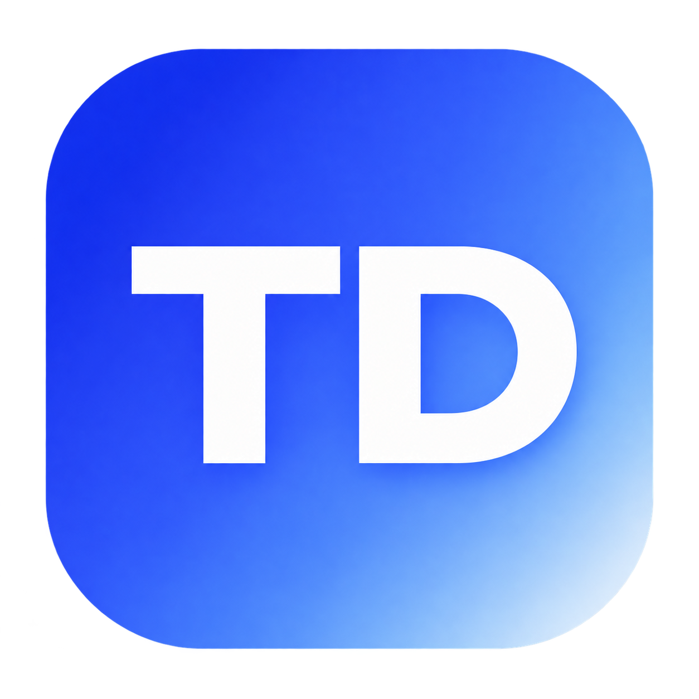

<div align="center">

  

# Trading Desk (TD)
### High-Performance Open-Source Indian Market Desktop Terminal
**Built with ❤️ for Indian Traders — Powered by Vela & FYERS API v3**

  <p>
    <strong>Zero Subscriptions · Zero 15-Minute Delays · Zero Annoying Ads · 100% Local & Open-Source</strong>
  </p>

  <p>
    <a href="#features">Key Features</a> •
    <a href="#why-fyers">Why FYERS?</a> •
    <a href="#quick-start-desktop-app">Download & Install</a> •
    <a href="#step-by-step-fyers-setup">FYERS Setup Walkthrough</a> •
    <a href="#running-from-source">Run from Source</a> •
    <a href="#license">License</a>
  </p>

</div>

---

## The Story: Built for Indian Traders

Most retail traders in India face the same frustrating limitations every single day:
- **15-Minute Delays** on Indian stock and index charts unless you pay expensive monthly subscriptions.
- **Paywalled Pro Features**: Basic necessities like 2+ indicators, multi-chart layout grids, and volume profiles locked behind recurring paywalls.
- **Intrusive Ads and Popups** interrupting your intraday trading execution.
- **Cloud Restrictions**: Your private indicators, custom Pine Scripts, and trading layouts locked into third-party cloud servers.

**Trading Desk solves this completely.**

Trading Desk takes the lightning-fast, WebGL2-accelerated open-source charting engine from **Vela**, integrates it with **FYERS API v3**, and packages it into a native, local-first desktop application.

> **100% Free Forever. 100% Your Code. 100% Your Data.**  
> Trading Desk runs directly on your local computer. It does not contact any third-party subscription servers. Your API credentials, Pine Scripts, charts, and drawings stay entirely on your local machine. You have full ownership because this project is 100% free and open-source.

---

## ⚡ Core Features

| Feature | Trading Desk | Commercial Alternatives |
| :--- | :--- | :--- |
| **Real-Time Indian Market Data** | **Real-Time Tick Streaming (0s Delay)** | Often 15-min delayed without paid add-ons |
| **Pricing / Subscription** | **Free & Open-Source Forever** | ₹1,200 – ₹5,000+ per month |
| **Advertisements** | **Zero Ads or Banners** | Intrusive upgrade banners & popups |
| **Simultaneous Indicators** | **Unlimited** (Multi-pane & overlays) | Capped at 2 or 3 on free tiers |
| **Multi-Chart Layouts** | **Unlimited** (1, 2, 4, 8 grid layouts) | Locked behind paid tiers |
| **Custom Indicators & Scripts** | **Built-in Monaco Pine Script v5 Editor** | Restricted script saves |
| **Chart Drawings & Plotting** | **Unlimited Drawings & Local Saves** | Capped layouts / cloud limits |
| **Data Privacy & Storage** | **100% Local on Your Machine** | Tracked and stored on cloud servers |

### Detailed Breakdown

1. **LIVE TICK DATA (No 15-Minute Delay)**  
   Direct WebSocket tick aggregation from Indian exchanges (NSE & BSE) through your own free FYERS API connection. Every candle updates tick-by-tick in real-time.
2. **INDIAN MARKET DATA**  
   Full coverage for Indian equities, indices (NIFTY 50, BANKNIFTY, SENSEX), and major sectors.
3. **NO ANNOYING ADS**  
   A clean, distraction-free trading workspace designed strictly for serious market analysis and execution.
4. **UNLIMITED INDICATORS**  
   Stack as many indicators as your strategy requires across multiple panes and chart overlays simultaneously.
5. **MULTIPLE LAYOUTS**  
   Split your screen into multi-chart grids to monitor multiple timeframes (e.g. 1m, 5m, 15m, Daily) or multiple stocks side-by-side.
6. **UNLIMITED PLOTTINGS & DRAWINGS**  
   Trendlines, Fibonacci retracements, support/resistance zones, and text notes saved automatically to your local storage.
7. **CUSTOM PINE SCRIPT v5 INTEGRATION**  
   Includes a built-in Pine Script editor powered by Microsoft Monaco (VS Code engine). Write, compile, and run Pine Script indicators directly on your live charts with one click.
8. **SMOOTH & FAST EXPERIENCE**  
   Native WebGL2 rendering ensures 60 FPS silky smooth panning, zooming, and crosshair movement without lag.

---

## Why Do We Need FYERS?

To display live, real-time Indian stock market charts without charging users monthly data subscription fees, Trading Desk connects directly to **FYERS**.

- **Free Broker API**: FYERS provides free API v3 access to all trading account holders.
- **Direct Exchange Feed**: Delivers official real-time trade ticks and historical OHLCV data directly from NSE and BSE.
- **Zero Intermediary Fees**: By using your own FYERS credentials, you eliminate the need for expensive third-party market data subscriptions.
- **Strict Privacy**: Your credentials and tokens are stored in your local computer's user data directory (`userData/vela-data`). They are never transmitted to any external server.

---

## 🚀 Quick Start: Desktop App (No Coding Required)

You do **not** need Node.js, Git, or VS Code installed to use Trading Desk.

1. Go to the [Releases](https://github.com/Raghunadh-Hital/trading-desk/releases) page on GitHub.
2. Download either:
   - **Installer**: `Trading Desk Setup 0.10.17.exe` (Recommended: installs silently, creates a Desktop shortcut with the official icon, and adds it to your Start menu).
   - **Portable**: `Trading Desk 0.10.17.exe` (Runs directly without installation).
3. Double-click the file to launch Trading Desk.

---

## 📖 Step-by-Step FYERS Setup Walkthrough

When you open Trading Desk for the first time, you will see a spacious **3-Step Onboarding Screen**. Follow these simple steps:

### Step 1: Configure Your App on FYERS

1. Log in to your FYERS trading account and visit the [FYERS API Dashboard](https://fyers.in/web/api-dashboard/user-apps).
2. If you do not have an app yet, click **+ Create App**. If you already have one, click on your app and select **Edit details**.
3. Under **App Info**, configure the following:
   - **Primary IP address\***: Click the **[Copy IP]** button in Trading Desk to copy your detected public IP address, and paste it into FYERS.
   - **Redirect URL\***: Click the **[Copy URL]** button in Trading Desk to copy `http://127.0.0.1:5000/api/auth/callback`, and paste it into FYERS.
   - **Permissions**: Ensure **Historical data, Quotes and market data** (and Orders) are granted.
4. Click **Save Changes** on the FYERS dashboard.

### Step 2: Save Your API Credentials in Trading Desk

1. In your FYERS dashboard, look at the right-hand panel under **App credentials & info**:
   - Copy the **App ID** (e.g. `XC12345-100`).
   - Click the eye icon to reveal and copy your **Secret ID**.
2. Return to Trading Desk and paste both into **Step 2**.
3. Click **Save Credentials**.  
   You will see an instant confirmation: `✓ Credentials saved successfully! Step 3 is now unlocked.`

### Step 3: 1-Click Login via Your Browser

1. Click the highlighted **Log in with FYERS (1-Click)** button.
2. Your default system browser (Chrome/Edge/Brave) will open the official FYERS login page.
3. Complete authentication with your mobile number / Client ID, OTP, and PIN.  
   *(Because authentication occurs in your standard browser, Cloudflare verification passes smoothly without blocking).*
4. Once authorized, FYERS redirects back to your local proxy, Trading Desk automatically receives your session token, and your live charts immediately unlock!

---

## 🛠️ Running from Source (For Developers)

If you wish to build or customize Trading Desk from source code:

### Prerequisites

- [Node.js](https://nodejs.org/) (v20+ recommended)
- `npm` (v10+ recommended)
- Python 3 with Pillow (`pip install Pillow`) for icon generation (optional)

### Setup & Development

```bash
# 1. Clone the repository
git clone https://github.com/your-username/trading-desk.git
cd trading-desk

# 2. Install dependencies
npm install
npm install --prefix server

# 3. Start the local proxy server
npm run server

# 4. In a separate terminal, launch the desktop development app
npm run electron:dev
```

### Building Desktop Installers

To package the production `.exe` installers:

```bash
npm run electron:build
```

The output binaries will be generated inside the `release/` folder:
- `release/Trading Desk Setup 0.10.17.exe` (One-click NSIS installer with desktop shortcut)
- `release/Trading Desk 0.10.17.exe` (Standalone portable executable)

---

## 🏛️ Architecture & Ground Rules

- **Headless Core**: Powered by Vela's WebGL2 financial charting library.
- **Local Proxy Server**: A lightweight Express/TypeScript server running on `127.0.0.1:5000` manages FYERS WebSocket streams, tick aggregation, token renewals, and symbol lookups.
- **Zero Mock Ticks**: Strictly real exchange trade data. When markets are closed (e.g. after 3:30 PM IST), charts remain 100% static with no synthetic price jiggling.
- **Local Persistence**: Indicator states, layouts, and drawings persist in your local IndexedDB / localStorage.

---

## 📄 License & Attribution

Trading Desk is open-source software licensed under the **Apache License 2.0**.

- Charting engine foundation powered by [Vela](https://velacharts.dev) by LuxAlgo under Apache-2.0.
- Indian market data integration powered by [FYERS API v3](https://fyers.in).
